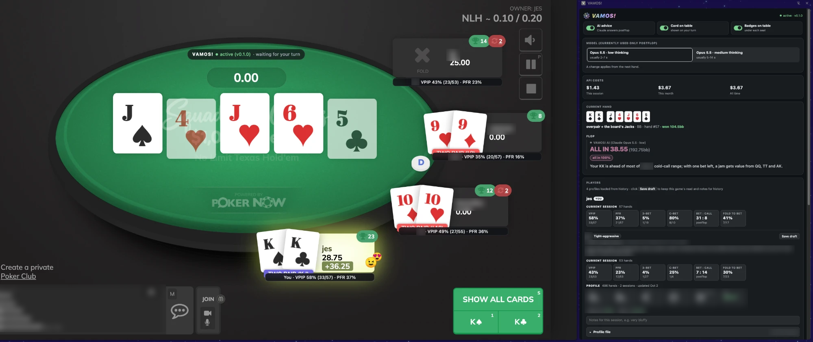
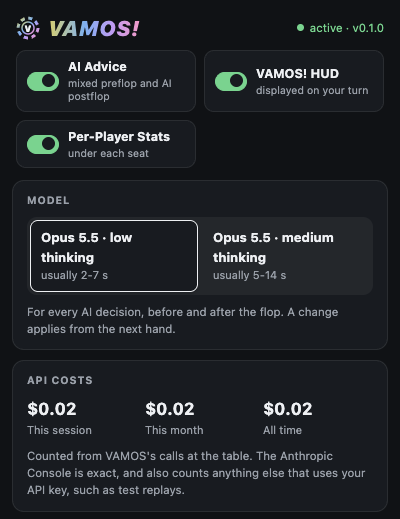
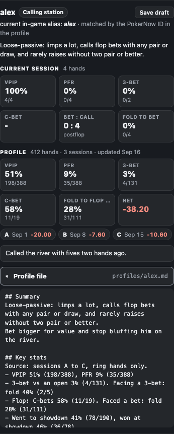
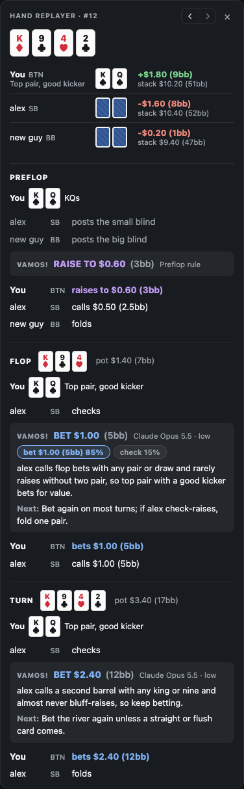

# VAMOS!

**A real-time, exploitative poker AI assistant for online home games.**

*Last updated: 10/13/2026*

Hello, and welcome to **VAMOS!**, a real-time poker AI assistant that gives you decision advice and insights while you play, to help you win and to learn the game.
At its core, **VAMOS!** does two things:

1. **It reads the table as you play.** It records the full game state (stack sizes, blinds, every action, hole cards and runouts) and computes stats on every opponent, such as VPIP, PFR and c-bet %, shown on the table and in a side panel.
2. **It learns your opponents and exploits them.** It keeps a written profile of each opponent's playstyle and tendencies and feeds those profiles, the hand and the stats to an AI model that recommends the most exploitative play.
   This is *continual learning*: after each session, one click has the AI rewrite every profile from the new hands, so each one keeps getting sharper the more you play against that person.

It also saves every hand you play, and its built-in *hand replayer* walks through any hand of the session street by street, with what **VAMOS!** advised next to what you actually did.

**VAMOS!** is technically the second version of my poker AI assistant (*PAIv2*); you can find the first, *PAIv1*, [here](https://github.com/JessupByun/PAIv1).
The name comes from my friends' and my favorite poker celebration.



*A real hand from my home game, with the side panel open. Player names, a profile's text and results, and the table chat are blurred.*

## Background and motivation

As an avid recreational player who plays in a small online home game with 3-4 friends, I wanted to build something that could keep up with my opponents.
I also wanted to explore whether exploitative play driven by a general-purpose AI model, rather than a purpose-built poker AI, can outperform game-theory optimal (GTO) play against low- to intermediate-level players.

GTO play is designed to be unexploitable, not to make the most money against any particular opponent, so against players with big, repeated patterns, adjusting to those patterns can win more.
Of course, exploiting a player leaves you open to being exploited back, but at recreational tables, where opponents rarely adjust, I believe exploitative play is clearly more profitable than GTO.

The best-known superhuman poker AIs, *Libratus* (Carnegie Mellon, 2017, heads-up) and *Pluribus* (Carnegie Mellon and Facebook AI Research, 2019, six-player), are purpose-built systems that use counterfactual regret minimization (CFR) and real-time search.
However, neither is open-source:

- **Libratus** was licensed exclusively to a private company.
- **Pluribus**'s researchers withheld their code because poker is played commercially, judging that the risk of releasing it outweighed the benefits.

Today's strongest poker agents, such as GTO Wizard AI, are commercial and closed-source as well.
Naturally, for ease of implementation, interpretability (the model explains every decision in plain language) and plain curiosity, I chose a large language model (LLM) as the core decision engine.

I also believe the paradigm of AI-assisted poker is going to grow (very fast).
*Real-time assistance* (RTA), software that tells a player what to do mid-hand, is already a problem online: sites like GGPoker have banned accounts and confiscated winnings over it.
LLMs make an assistant like this far easier to build, and as models keep getting cheaper and smarter, I think it's likely that within a few years AI seriously damages the integrity of online poker, unless detection keeps up.
**VAMOS!** is one of a growing number of LLM-based poker assistants, and tools like it raise real ethical concerns, which is why I've only used it in a private game where everyone knows about it (see [Fair play and ethics](#fair-play-and-ethics)).

## The core idea

My claim is that today's frontier LLMs reason well enough that, given real exploitative information about the people you're playing, they can outplay recreational players.
Not by approximating unexploitable play, but by doing what a good player does against familiar opponents: noticing that someone calls way too much, never bluffs the river or folds to every 3-bet, and adjusting to it.

Good players already do a version of this:

- **Notes.** Most online poker sites let you keep notes on each opponent, since in a game played over and over, you naturally build a mental map of how each person plays.
- **Post-game analysis.** A step further is reviewing hands after the game and computing real statistics on each player.
- **The hard part.** These insights give you an edge, but it's hard for anyone to keep every player's numbers and tendencies in mind while making split-second decisions.

**VAMOS!** takes the next step: it applies a registry of every opponent's tendencies and statistics in real time, through a decision engine that exploits each player individually.
With an LLM, that registry is simply a set of Markdown profiles that go into every prompt, cached so it stays cheap.

At its core, **VAMOS!** is:

- a **Chrome extension** that reads the game state,
- a **local Python backend** that rebuilds every hand and works out the stats, and
- an **API call to an AI model** that makes the decision, with a profile of every opponent at the table.

It only reads and shows you things: it never clicks or types anything into PokerNow, so you still make every decision yourself.

**It's built to be modular:**

- **The site.** It's built for PokerNow today, but nothing in the pipeline depends on PokerNow except the parts that read the game state. Any site whose game state can be read in real time could be supported, and a coding agent could likely do most of that port from a few example hand histories.
- **The model.** The AI sits behind one small provider class ([`src/vamos/brain/provider.py`](src/vamos/brain/provider.py)), so switching to another model or API provider is mostly a matter of writing one more. **VAMOS!** currently runs on *Claude Opus 5.5* at low thinking effort.
- **The trend.** These models will only keep getting cheaper and smarter, especially open-source models you could run locally.

## Results

Across 15 real sessions with my friends, from heads-up to 5-handed, **VAMOS!** is up **765 big blinds over 1,493 hands**.
That's about **51bb/100**, or roughly 15 buy-ins (we buy in for 50bb), and **VAMOS!** won **11 of the 15 sessions**.

| Players dealt in | Hands | Result | bb/100 |
|---|---|---|---|
| 2 (heads-up) | 569 | +254bb | 45 |
| 3 | 514 | +335bb | 65 |
| 4 | 279 | +88bb | 31 |
| 5 | 131 | +88bb | 67 |
| **All** | **1,493** | **+765bb** | **51** |

Every number comes from the hand histories **VAMOS!** saved.

*One caveat:* 1,500 hands is a small sample in poker, and this is an observational record rather than a controlled experiment, so it doesn't establish statistical significance.

## How it works

- **Reading the table.** The extension reads PokerNow's own game log (the same one you can download after a game) and a few things from the page: whose turn it is, your cards, the seats and the timer. The backend rebuilds every hand from the log, so the pot, stacks and action are exact, not guessed from the screen.
- **The stats.** Pot odds, stack-to-pot ratio, your made hand, your draws and outs, and this session's numbers on every player (VPIP, PFR, 3-bets, c-bets, folds to bets) are all worked out in code.
- **Preflop.** Heads-up at 10bb or less, a *push/fold chart* answers (solved here and checked against HoldemResources' Nash charts). Clear spots, like folding trash 3 or more handed or raising the best hands, are answered by *simple rules*. Everything else goes to the AI.
- **AI decisions.** Every other decision, before and after the flop, goes to the AI model with the profiles of the opponents at the table, the whole hand so far, the stats and your notes. It answers with an action and a size, sometimes a mix ("bet 85%, check 15%"), one sentence on why, and a plan for the next street. *Ask deeper* asks again with more thinking effort and shows both answers so you can compare.
- **The card.** On your turn, a small card above the pot shows the action, the size in dollars and big blinds, the mix, and where the advice came from: `Preflop chart`, `Preflop rule`, or the AI with its model named, currently `VAMOS! AI (Claude Opus 5.5 · low)`.
- **The badges.** Under each seat, the player's name and this session's VPIP and PFR.
- **The side panel.** Everything else, covered [below](#side-panel).


*The card and the badges on a sample table made for this README.*
- **Privacy.** The AI never sees a real name or nickname: opponents are "Player A", "Player B" and so on, and you're "Hero". Everything **VAMOS!** saves stays on your computer, in `data/`.

## Side panel

Click the **VAMOS!** icon in Chrome to open a side panel next to the table.

- **Switches, model and costs.** Turn the AI advice, the card on the table and the seat badges on or off, pick low or medium thinking effort, and see what the AI has cost this session, this month and all time.
- **Current hand.** Your cards, your made hand and position, and every AI decision in the hand street by street, each with the AI's reasoning and its plan for the next street. *Ask deeper* is here too.
- **Hand replayer.** Pick any earlier hand from the session and go through it street by street: the board, everyone's cards that were shown, every action, and what **VAMOS!** said before each of your decisions next to what you actually did.
  - The menu marks the biggest pots and colors wins and losses.
  - You can filter it to hands you played, big pots, AI decisions or showdowns.
  - *Previous* and *next* buttons step through the session.
- **Players.** Everyone at the table, with their profile tag and summary, this session's stats (VPIP, PFR, 3-bet, c-bet, bets to calls and fold to a bet), the same stats from their profile across every session, and their result in each session.
- **Notes.** A notes box for each player this session, like "tilted" or "very bluffy". Your notes go to the AI with every decision, under the same pseudonyms.
- **Profile viewer.** Open anyone's whole profile file right in the panel.
- **Update profiles.** After a session, rewrite every profile from the new hands with one click (see [Opponent profiles](#opponent-profiles)), or start a profile for a new player with *New profile...* in their profile menu.
- **Matching and drafts.** Match a new PokerNow account to an existing profile (friends switch devices and accounts), and *Save draft* writes a player's session numbers and your notes to `drafts/` so you can look them over.

<table>
<tr>
<td valign="top" width="33%"><br></td>
<td valign="top" width="33%"></td>
<td valign="top" width="33%"></td>
</tr>
</table>

## Opponent profiles

**The profiles are where the edge comes from.**
Each opponent gets one Markdown file in `profiles/` with:

- their exact stats,
- how they play each street, their bet sizing, how they bluff and how they tilt, and
- a ranked list of how to exploit them,

with every read backed by counts or specific hands.
The AI reads the whole profile of everyone at the table at every decision.

**Continual learning.** This is how **VAMOS!** learns: the profiles are rewritten after every session from what actually happened, so the more you play someone, the sharper their profile gets.
Every profile follows one rulebook, [`profiles/_GUIDELINES.md`](profiles/_GUIDELINES.md), which sets the sections, the stat definitions and how much evidence a read needs.

There are three ways to update them:

1. **The Update profiles button** (side panel, under Players). One click after a session:
   - **VAMOS!** finds every profiled player with new hands, counts their stats exactly and gathers every hand they played.
   - It shows you who will be updated and roughly what it will cost (about $0.50 per player), and runs only once you confirm.
   - The AI model (currently Claude Opus 5.5, high thinking) rewrites each profile under the rulebook, with every name pseudonymized like at the table.
   - Code then writes the profile's numbers itself (hands, sessions, net results and the headline stats) from the exact counts, so they never depend on the model's arithmetic.
   - Every earlier version is kept in `data/profile-history/`, and *Undo* puts the last update back.
2. **An agent session on a subscription plan.** Updating profiles uses a lot of tokens, so a coding agent on a subscription you already pay for (Claude Code, Codex or similar) is a good way to save API costs. `uv run python scripts/prepare_profile_update.py` writes each player's exact counts and hands to a work folder; the agent writes the new profiles under the rulebook, and `--install <work folder>` checks and installs them.
3. **By hand.** The profiles are plain Markdown files and they're yours: edit them whenever you like.

**Starting a profile.** Play a session or two with someone, then choose *New profile...* in their profile menu in the side panel and give it a name. The AI builds the profile from every hand of theirs **VAMOS!** has saved.

## Design principles

- **Read only.** **VAMOS!** never touches the game. You see the advice and you decide.
- **Exact state or nothing.** Every hand is rebuilt from the log, and advice is stamped with the exact decision it was for, so it never shows once the spot has moved on.
- **Math in code, judgment in the model.** Anything that can be computed exactly is computed and handed to the AI, which is told to trust those numbers. The model only does what it's good at: reading people and making the call.
- **A short prompt.** No strategy guide, no ranges, no solver output: just a short role, the profiles, the hand and the stats. *The model already knows poker; what it doesn't know is your friends.*
- **Continual learning through the profiles.** There's no other stats engine or model training. The profiles get rewritten after every session from exact counts, under one rulebook, and that's the whole learning loop.
- **Say where advice came from, and say when something breaks.** Every piece of advice is labeled with its source. When the AI call fails, the API key is missing or PokerNow's log stops answering, the card says so instead of quietly falling back.
- **Don't cut quality to save money.** Every AI decision uses a frontier model (currently Opus 5.5), and the profiles are cached so that stays affordable.
- **Standard poker terms.** No made-up labels, and calm colors: only the action itself is colored.

## Installation and setup

**Requirements**

- **OS and browser:** macOS (Apple Silicon or Intel) or Linux (x86_64), with Google Chrome. Windows isn't supported yet.
- **[uv](https://docs.astral.sh/uv/)** for the Python side; it installs Python 3.12 for you.
- **Node.js 22.12 or newer** to build the extension.
- **An API key for the AI model.** Currently that's an Anthropic key with access to Claude Opus 5.5, from [platform.claude.com](https://platform.claude.com). Another provider needs its own provider class (see [The core idea](#the-core-idea)).

**Install**

```bash
git clone https://github.com/JessupByun/VAMOS.git
cd VAMOS
uv sync
cp .env.example .env
uv run vamos install
cd extension && npm ci && npm run build
```

**Configure**

1. Put your API key in `.env`.
2. In Chrome, go to `chrome://extensions`, turn on *Developer mode*, click *Load unpacked* and pick `extension/dist`.
3. Tell **VAMOS!** your own names (your real name and any nicknames), so they're replaced with "Hero" before anything reaches the AI and the profile update knows which player is you:

   ```bash
   mkdir -p data
   echo '{"heroNames": ["yourname", "your nickname"]}' > data/settings.json
   ```

4. Open a PokerNow game and click the **VAMOS!** icon to open the side panel. If you don't see the icon, pin it from Chrome's extensions (puzzle piece) menu.

*Good to know:*

- `vamos install` registers the backend with Chrome, so Chrome starts it when you open a PokerNow table and stops it after you close the last one. If you move the folder, run it again.
- After pulling changes, rebuild the extension, then reload **VAMOS!** in `chrome://extensions` and reload the PokerNow tab.
- When a new player sits down, their badge offers to match them to a profile; **VAMOS!** remembers the answer for that PokerNow account.

## Costs

The 15 sessions above came to about **$11 in API costs**, a bit under **$1 an hour** of play with the AI on.
Updating the profiles with the button costs about **$0.50 per player** per update, and the side panel shows the estimate before it runs.
The side panel shows what this session, this month and all time have cost, profile updates included.
With the AI switched off in the side panel there are no API calls at all; the preflop chart, the rules and the stats keep working.

## Fair play and ethics

**Only use VAMOS! in games where everyone knows about it and agrees to it.**
Using it on people who don't know can be classified as cheating.

It's also likely against most online poker sites' terms of service.
[PokerNow's](https://network.pokernow.com/service_terms), for example, prohibit automated scraping of the site and using it for real-money games.
Use it at your own risk.

## Directory structure

| Folder | Contents |
|---|---|
| `src/vamos/` | The backend Chrome starts: the log parser, the hand engine and stats, the preflop chart and rules, the AI calls, and the hand replayer. |
| `extension/` | The Chrome extension: the card and badges on the table, and the side panel. |
| `profiles/` | Your opponent profiles (kept out of git) and the rulebook they follow, `_GUIDELINES.md`. |
| `scripts/` | Developer tools: preparing a profile update for an agent session, the preflop chart generators, and replays of logged spots. |
| `docs/` | Notes on PokerNow's log and page, the full log grammar, and how preflop advice works. |
| `tests/` | The test suite. |
| `data/` | Created as you play, and kept out of git: saved games, settings, seat matches, every AI call, costs and logs. |
| `drafts/` | Where the side panel's *Save draft* writes a player's session notes and numbers. |

## Development and testing

```bash
uv run pytest
uv run ruff check . && uv run ruff format --check .
cd extension && npm run typecheck && npm test
npx playwright install chromium   # once, for the browser tests
npx playwright test
```

The browser tests run the real backend in a throwaway Chrome against a fake PokerNow table, and the AI's answers are canned, so no test ever calls an API.
[`CLAUDE.md`](CLAUDE.md) has the full guide to the code, whether you're working on it with an AI coding agent or by hand.

## License

[MIT](LICENSE)
