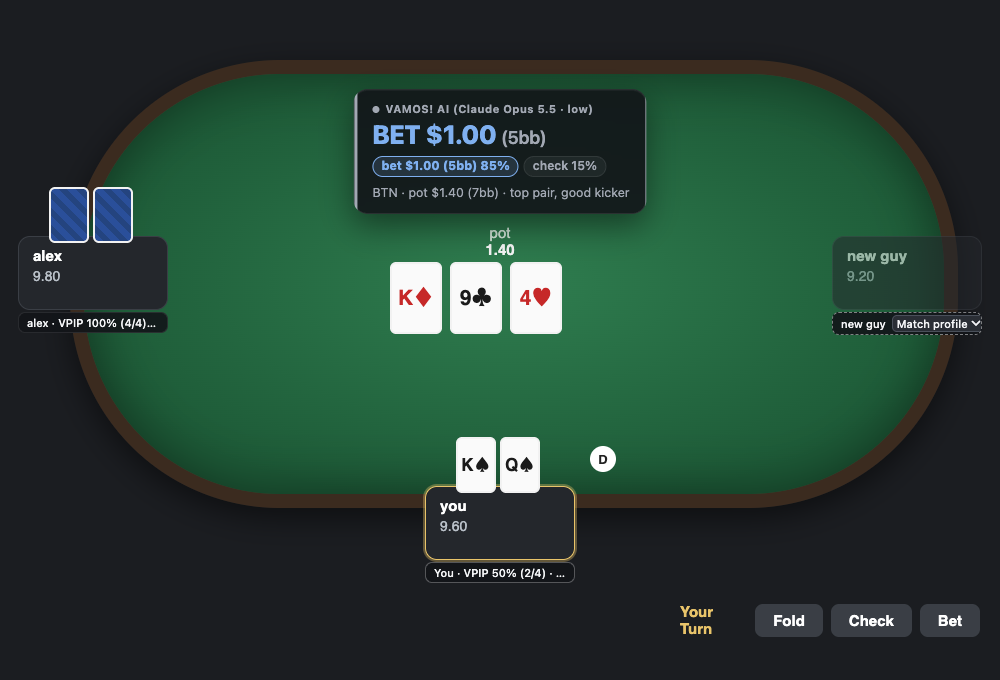
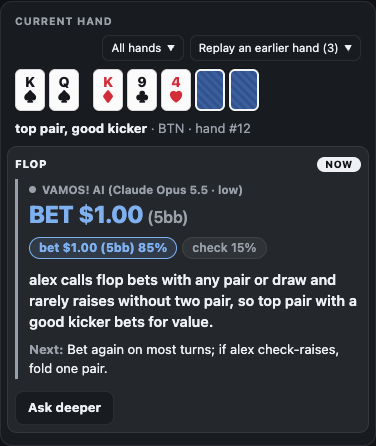

# VAMOS!

A real-time poker assistant for PokerNow home games.
It reads the table while you play, does the math in code, and asks Claude what to do, with a profile of how each person at your table actually plays.



*A made-up table for the screenshot. The card at the top is VAMOS, everything else stands in for PokerNow.*

## Why "VAMOS!"

It's a saying me and my friends use when we play.
That's the whole story, it just felt like the right name.

## What this is

I play in a small online home game on PokerNow with a few friends, usually 3 or 4 of us, sometimes heads-up.
I wanted to see how far an LLM could go as the decision engine if it actually knew the people it was playing against.
So VAMOS is basically that: a Chrome extension that reads the game, a local Python backend that rebuilds every hand and works out the stats, and Claude Opus 5.5 making the close decisions with a profile of every opponent at the table.

It only reads and shows you things.
It never clicks or types anything into PokerNow, you still make every decision yourself.

## The idea

My take is that current models (Opus 5.5) are good enough now that, given real exploitative information about the people you're playing, they can outplay recreational players.
Not by solving poker, but by doing what a good player does against their friends: noticing that someone calls way too much, or never bluffs the river, or folds to every 3-bet, and adjusting to that.

I think systems like this are going to get a lot more common, and they're going to break online poker.
The serious versions won't run on a general model like Claude.
They'll have a proprietary ML model as the decision engine, with the same kind of setup around it: something reading the table in real time, something tracking every player, and all of it fed to the model at every decision.
VAMOS is just an at-home version of that, but I think it's a pretty good one.

## Results

Across 15 sessions, from heads-up up to 5-handed, I'm up 765 big blinds over 1,493 hands.
That's about 51bb/100, or around 15 buy-ins (we buy in for 50bb), and I won 11 of the 15 sessions.

| Players dealt in | Hands | Result | bb/100 |
|---|---|---|---|
| 2 (heads-up) | 569 | +254bb | 45 |
| 3 | 514 | +335bb | 65 |
| 4 | 279 | +88bb | 31 |
| 5 | 131 | +88bb | 67 |
| All | 1,493 | +765bb | 51 |

All 15 sessions were played between Oct 4 and Oct 8, 2026, and every number comes from the hand histories VAMOS saved.
Test tables, and one session where I wasn't sure who I was playing, are left out.

Some honesty about these numbers:
- 1,500 hands is a small sample in poker, and my friends are recreational players, not regs.
- The AI was on for most spots in 9 of the sessions (+515bb over 1,023 hands). In the other 6 I had it off or barely used it (+250bb over 470 hands), so I can't tell you exactly how much of the edge is VAMOS and how much is me.
- I think it's best 3 or 4 handed, where the profiles matter most.

## How it works

- **Reading the table.** The extension reads PokerNow's own game log (the same one you can download after a game) and a few things from the page: whose turn it is, your cards, the seats and the timer. The backend rebuilds every hand from the log, so the pot, stacks and action are exact, not guessed from the screen.
- **The stats.** Pot odds, stack-to-pot ratio, your made hand, your draws and outs, and this session's numbers on every player (VPIP, PFR, 3-bets, c-bets, folds to bets) are all worked out in code.
- **Preflop.** Heads-up at 10bb or less, a push/fold chart answers (solved here and checked against HoldemResources' Nash charts). Clear spots, like folding trash 3 or more handed or raising the best hands, are answered by simple rules. Everything else goes to Claude.
- **Claude.** Every other decision, before and after the flop, goes to Claude Opus 5.5 at low effort, with the profiles of the opponents at the table, the whole hand so far, the stats and your notes. It answers with an action and a size, sometimes a mix ("bet 85%, check 15%"), one sentence on why, and a plan for the next street. "Ask deeper" asks again at medium effort and shows both answers so you can compare.
- **The card.** On your turn, a small card above the pot shows the action, the size in dollars and big blinds, the mix, and where the advice came from (`Preflop chart`, `Preflop rule` or `VAMOS! AI (Claude Opus 5.5 · low)`).
- **The badges.** Under each seat, the player's profile tag and this session's stats.
- **The side panel.** The current hand with every AI decision and its reasoning, your notes on each player, their profile summary, a replayer for this session's earlier hands with what VAMOS said next to what you did, and what the AI has cost so far.
- **Privacy.** Claude never sees a real name or nickname: opponents are "Player A", "Player B" and so on, and you're "Hero". Everything VAMOS saves stays on your computer, in `data/`.



## Opponent profiles

The profiles are where the edge comes from.
Each opponent gets one Markdown file in `profiles/`, with their exact stats, how they play each street, their bet sizing, how they bluff, how they tilt, and a ranked list of how to exploit them, every read backed by counts or specific hands.
Claude reads the whole profile of everyone at the table at every decision.

VAMOS keeps them up to date itself.
After a session you open Claude Code in this folder and say "update the profiles".
A script counts the new hands exactly, then Claude Code agents rewrite each profile from those counts and every hand that player played, a second agent checks every number and hand against the data, and the corrections get applied.
Old versions are kept, so nothing is lost.
This runs on your Claude subscription through Claude Code, not your API key, since it's a lot of tokens.

To start a profile for someone, play a session or two with them, then ask Claude Code to create a profile for them under whatever name you want.
The rules every profile follows are in [`profiles/_GUIDELINES.md`](profiles/_GUIDELINES.md).

## Design principles

- **Read only.** VAMOS never touches the game. You see the advice and you decide.
- **Exact state or nothing.** Every hand is rebuilt from the log, and advice is stamped with the exact decision it was for, so it never shows once the spot has moved on.
- **Math in code, judgment in the model.** Anything that can be computed exactly is computed and handed to Claude, which is told to trust those numbers. Claude only does what it's good at: reading people and making the call.
- **A short prompt.** No strategy guide, no ranges, no solver output. Just a short role, the profiles, the hand and the stats. The model already knows poker; what it doesn't know is your friends.
- **Learning only through the profiles.** There's no other stats engine or model training. The profiles get rewritten after every session from exact counts, under one rulebook, and that's the whole learning loop.
- **Say where advice came from, and say when something breaks.** Every piece of advice is labeled with its source. When the AI call fails, the API key is missing, or PokerNow's log stops answering, the card says so instead of quietly falling back.
- **Don't cut quality to save money.** It runs Opus 5.5 on every AI decision, and the profiles are cached so that stays affordable.
- **Standard poker terms.** No made-up labels, and calm colors: only the action itself is colored.

## Setup

You need:
- macOS or Linux (x86_64), and Google Chrome. Windows isn't supported yet.
- [uv](https://docs.astral.sh/uv/) for the Python side (it installs Python 3.12 for you).
- Node.js 22.12 or newer for building the extension.
- An Anthropic API key with access to Claude Opus 5.5, from [platform.claude.com](https://platform.claude.com).
- [Claude Code](https://claude.com/claude-code), only if you want VAMOS to keep the profiles up to date.

Then:

```bash
git clone https://github.com/JessupByun/VAMOS.git
cd VAMOS
uv sync
cp .env.example .env
uv run vamos install
cd extension && npm ci && npm run build
```

1. Put your API key in `.env`.
2. In Chrome, go to `chrome://extensions`, turn on Developer mode, click "Load unpacked" and pick `extension/dist`.
3. Tell VAMOS your own names (your real name and any nicknames), so they're replaced with "Hero" before anything reaches Claude and the profile update knows which player is you. Create `data/settings.json` with:

   ```json
   {"heroNames": ["yourname", "your nickname"]}
   ```

4. Open a PokerNow game and click the VAMOS icon to open the side panel.

`vamos install` registers the backend with Chrome, so Chrome starts it when you open a PokerNow table and stops it after you close the last one.
If you move the folder, run it again.
After pulling changes, rebuild the extension, then reload VAMOS in `chrome://extensions` and reload the PokerNow tab.

When a new player sits down, their badge offers to match them to a profile; VAMOS remembers the answer for that PokerNow account.

## Costs

The 15 sessions above came to about $11 in API costs, a bit under $1 an hour of play with the AI on.
The side panel shows what this session, this month and all time have cost.
With the AI switched off in the side panel there are no API calls at all; the preflop chart, the rules and the stats keep working.

## Playing fair

Only use this in games where everyone knows about it and is fine with it.
My friends knew.
Using it on people who don't know is cheating.

It's also likely against PokerNow's [terms of service](https://network.pokernow.com/service_terms), which don't allow automated scraping of their site or using it for real-money games, so use it at your own risk.
VAMOS isn't affiliated with PokerNow or Anthropic.

## What's in here

| Folder | What it is |
|---|---|
| `src/vamos/` | The backend Chrome starts: the log parser, the hand engine and stats, the preflop chart and rules, the Claude calls, and the hand replayer. |
| `extension/` | The Chrome extension: the card and badges on the table, and the side panel. |
| `profiles/` | Your opponent profiles (kept out of git) and the rulebook they follow, `_GUIDELINES.md`. |
| `.claude/` | The Claude Code skill and workflow that update the profiles. |
| `scripts/` | Developer tools: the profile update's preparation, the preflop chart generators, and replays of logged spots. |
| `docs/` | Notes on PokerNow's log and page, the full log grammar, and how preflop advice works. |
| `tests/` | The test suite. |
| `data/` | Created as you play, and kept out of git: saved games, settings, seat matches, every Claude call, costs and logs. |
| `drafts/` | Where the side panel's Save draft writes a player's session notes and numbers. |

## Development

```bash
uv run pytest
uv run ruff check . && uv run ruff format --check .
cd extension && npm run typecheck && npm test && npx playwright test
```

The browser tests run the real backend in a throwaway Chrome against a fake PokerNow, and Claude's answers are canned, so no test ever reaches the API.
[`CLAUDE.md`](CLAUDE.md) has the full guide to the code, if you're working on it with Claude Code or by hand.

## License

[MIT](LICENSE)
